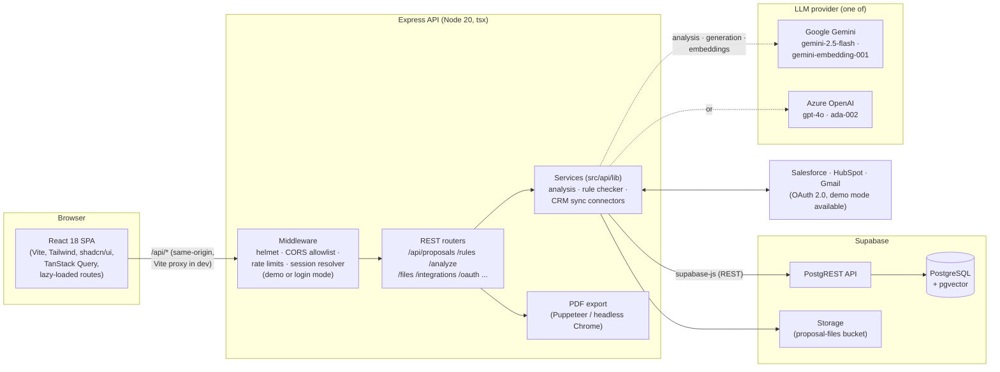

# DealSentry Architecture

DealSentry is an AI-assisted proposal compliance and risk review system. This
document explains how the pieces fit together and, more importantly, *why* —
including the trade-offs that were made deliberately.

## System overview



## Key design decisions

### 1. Two database access paths, on purpose

- **Runtime**: the Express API talks to Supabase over **PostgREST**
  (`supabase-js`). No connection pool to manage, works on serverless-ish free
  tiers, and survives the API host and database being in different regions.
- **Schema & seeds**: **Prisma** is used *only* for `db push`, `db execute`
  (the manual SQL in `prisma/manual/`) and `npm run seed`, over the Supabase
  **session-mode pooler** (port 5432 — Prisma migrations cannot run over the
  transaction pooler on 6543).

The trade-off: no compile-time query types at runtime (PostgREST returns
untyped JSON). That's the price of running well on a free tier; the routers
type their own row interfaces at the boundary instead.

### 2. Two authentication modes

`AUTH_MODE` (read on every request, see `src/api/lib/authConfig.ts`) selects:

- **`demo`** (default) — deliberately **no login screen**: every request is served
  as a default user (`DEMO_USER_EMAIL`, falling back to the first ADMIN). A valid
  bearer token still wins over the default identity.
- **`login`** — real multi-user mode. No default identity: a request without a valid
  token gets `401 AUTH_REQUIRED` and the SPA shows a sign-in page. Data is isolated
  per company, and users with no company only see what they own
  (`canAccessResource` / `listScope` in `middleware/auth.ts`). The server refuses to
  start in this mode without a real `NEXTAUTH_SECRET`.

Both modes share the same routes and middleware; the mode only changes how a
request's user is resolved and how strictly rows are scoped. Details and the
hardening around OAuth redirects: `docs/AUTH_QUICKSTART.md`.

### 3. AI with guardrails, and a fallback when the AI is gone

`/api/analyze` (`src/api/lib/analysisService.ts`) sends the proposal *content*
(source of truth) plus the active compliance rules to the configured model and
asks for structured findings. Hard limits (max 25% discount, 90-day payment
terms, mandatory legal clauses, $10k minimum deal) are stated in the prompt, and
`/api/proposals/generate` additionally re-validates and clamps what the model
returns (`proposalGeneration.ts`). Results are normalized (`normalizeAnalysis`)
before they become a RiskReport.

When the model is unconfigured, unreachable, times out, or returns unparseable
JSON, analysis does **not** fail: `ruleAnalysis.ts` answers the same questions
deterministically (it extracts the discount, deal value and payment term from the
text, checks for the required clauses and sections, and applies the thresholds from
the active `Rule` rows). The report carries an `ANALYSIS MODE` finding and the API
returns `analysisSource: "ai" | "rules"`, so the UI and reviewers can tell which
engine produced it. `ANALYSIS_MODE=rules` forces it.

The provider is chosen by `src/api/lib/llm.ts`: Gemini (through its
OpenAI-compatible endpoint) if `GEMINI_API_KEY` is set, else Azure OpenAI, else
none — resolved lazily so the server boots with no AI configured.

### 4. Semantic search via pgvector

Every proposal gets a 1536-dim embedding on create (best-effort — failures
never block the write). Search calls the `match_proposals` SQL function
(cosine distance, HNSW index). If the extension/function is missing the API
answers `available: false` and the client falls back to substring search —
the feature degrades, it doesn't break.

Vectors from different models are not comparable, so every instance sharing a
database must use the same embedding model; after changing it, re-embed with
`npm run backfill:embeddings -- --all`. Setup: `prisma/manual/semantic_search.sql`,
`docs/SEMANTIC_SEARCH.md`.

### 5. Integrations with a real demo mode

Salesforce/HubSpot/Gmail connect over standard OAuth 2.0. With
`*_DEMO_MODE=true`, connect stores `{demo: true}` credentials and **sync
imports canned deals as proposals**, so the connect → sync → analyze → approve
story is demonstrable without any external accounts.

Each CRM is its own connector under `src/api/lib/sync/` (`hubspot.ts`,
`gmail.ts`, `salesforce.ts`, `demo.ts`) behind one `runSync` dispatcher. They
refresh expired tokens, de-duplicate on the CRM record id *per user*, attach the
integration owner's user and company to everything they import, and time out
rather than hang. A failed sync is reported as `424` with the reason (and
`needsReconnect` when the connection is revoked), never as a silent `200`.

OAuth tokens never leave the server: integration responses carry a `hasCredentials`
flag instead. The `state` parameter is a signed, expiring token, and the SPA starts
the redirect with a 2-minute single-purpose token rather than its session token.
The Salesforce instance URL is validated against Salesforce's domains before any
request is made (it lives in user-editable credentials, so it is an SSRF vector).

### 6. Deployment (Render, Docker)

One container serves both the API and the built SPA (Express serves `dist/` in
production, so CORS is a non-issue for same-origin traffic). The runtime image
installs system Chromium for PDF export (`PUPPETEER_EXECUTABLE_PATH`), because
the free tier's 512 MB can't afford Puppeteer's bundled download at build time;
exports run one at a time and always close the browser. The server trusts one
proxy hop in production (`TRUST_PROXY`) so per-IP rate limits see real visitors.
`render.yaml` is a full Blueprint — secrets are dashboard-only (`sync: false`).

### 7. Frontend delivery

Every page is a lazy route (`React.lazy` in `App.tsx`), and `vite.config.ts` groups
React, the router, Radix, animation and chart libraries into separate vendor
chunks — so the first load carries the shell and the chart library is fetched only
by the pages that draw charts.

## Security model (current state and roadmap)

| Area | Today | Next step |
| --- | --- | --- |
| API auth | `demo` (default) or `login` mode with email + password, signed 7-day tokens, per-company isolation | Password reset, email verification, 2FA, server-side token revocation |
| DB access | Server-side key via supabase-js; the service-role key is preferred when set | **Enable RLS** — `prisma/manual/enable_rls.sql`, guarded by `npm run check:rls`. Until then the anon key can read every table |
| Secrets | `.env` git-ignored; Render dashboard for prod; OAuth tokens never sent to the browser | Rotate any key that was ever committed (`CREDENTIALS.md` is in git history) |
| Responses | Password hashes stripped everywhere; mutations admin-gated; production errors are generic | Field-level DTOs |
| Files | Per-user folders, type allow-list, size cap, signed links; traversal rejected | Virus scanning if untrusted users upload |
| Dependencies | `npm audit fix` applied; 0 critical | Major upgrades listed in `docs/DEPLOYMENT.md` §7 |

## Repository map

```
server.ts                 Process bootstrap: env, startup checks, listen, graceful shutdown
src/api/app.ts            createApp(): middleware, routes, SPA serving, error handler (testable)
src/api/*.ts              One router per resource
src/api/middleware/       Session resolution (demo/login), access helpers, rate limits
src/api/lib/              Services: analysisService, ruleAnalysis, llm, embeddings,
                          proposalPdf, proposalGeneration, proposalStore, oauthState,
                          integrationStore, authConfig, logger, sync/ (CRM connectors)
src/lib/                  API client (frontend), supabase client (backend), utils
src/hooks/                use-session (auth state), use-api-connection
src/pages/ components/    React SPA
prisma/                   schema.prisma, seed.ts, manual/*.sql (pgvector, storage, multi-user, RLS)
scripts/                  backfill-embeddings, check-rls, migrate-auth (set-passwords), cleanup-integrations
tests/                    Vitest + Supertest API tests (tests/helpers/supabaseMock.ts is the shared DB stand-in)
```
